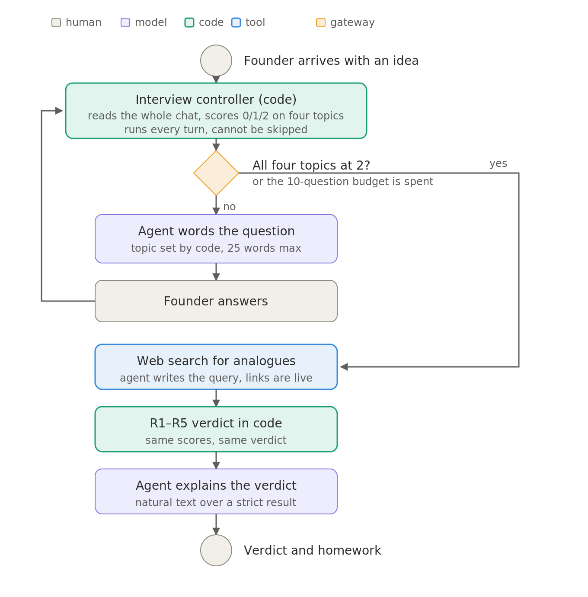

# AI Screener for Startup Accelerator Applications

An AI interviewer that does the first-pass screening of startup applications: in 4–10 questions it checks whether there are facts behind the idea, looks up the market, and issues a pass or fail verdict computed by deterministic code, with targeted homework for the founder.

Built in [Langflow](https://langflow.org) for the accelerator programme of a major bank.


<p align="center">
  
</p>

## The product case

**Problem.** Accelerator experts spend their first call with every applicant on the same basic questions, and most ideas fail them. Experts' time goes to screening instead of the strongest teams.

**User.** The founder gets a short interview and clear homework. The programme team gets a consistent verdict before any expert time is spent.

**Key decision: the model speaks, the code decides.** In the first version the interview logic was a tool the agent was "supposed" to call. In practice it called it on one turn out of five. I moved the logic into a controller that runs on every turn, and left the model only the wording. Controller runs went from 1 in 5 to 5 in 5.

**Quality bar.** Four topics, each scored 0, 1 or 2, based on Customer Development, The Mom Test, Jobs to Be Done and Lean Startup. An application passes only with 2 on all four. The verdict rules (R1–R5) are plain code, so the same scores always give the same result.

**Model choice.** The flow is model-agnostic. I compared seven models for the interviewer role; only one held the two-attempt rule without hinting at the answer.

| Role | Model | Why |
|---|---|---|
| Interviewer | DeepSeek V4 Flash | The only one of seven that kept the rules |
| Scoring | gpt-oss-120b | Strict JSON, temperature 0, three times faster (6.9 s vs 19.6 s) |
| Web search | YandexGPT search tool | Returns live links to similar products |

**Results (synthetic runs).** 6–20 s per turn, 4–5 questions against a budget of 10, about $0.15 per application.

**What it would take to go live.** A labelled set of real applications scored by experts, to measure how often the AI agrees with them. Scores still come from a model, so this is the precondition for production use.

## Architecture

```
Chat Input ─┬──────────────────────────────► Agent (input)
            └──► Interview Controller ──────► Agent (system prompt)

Chat Model ─────────────────────────────────► Agent (model)
Verdict R1-R5 (tool) ───────────────────────► Agent (tools)
Web Search (tool) ──────────────────────────► Agent (tools)
Agent ──────────────────────────────────────► Chat Output
```

| Component | Role | Who decides |
|---|---|---|
| Interview Controller | Scores answers, keeps counters and the question budget, picks the next topic, builds the agent's prompt | Code |
| Agent | Phrases the question, explains the verdict | Model |
| Verdict R1-R5 | Applies the pass rules to the scores | Code |
| Web Search | Finds similar products, returns live links | Tool |

## How to run

1. Run Langflow (tested with Python 3.14 in Docker).
2. Build the flow from the diagram, pasting the component code from `components/`.
3. Add your API keys in the model, search and controller components.

There is no ready-to-import flow JSON: the current version is fully described by `components/`.

## Known limitations

- Scores come from a model, so the same transcript can be graded slightly differently.
- No labelled dataset yet, so scoring consistency is not measured.
- The scoring call has a 90 s timeout; a hung request once made a turn take ~96 s.

## Repository

| Folder | Contents |
|---|---|
| `components/` | Custom Langflow components, one file each |
| `docs/WORKFLOW.md` | Debugging log: model comparison, prompt drift and fixes |
| `presentation/` | Flow diagram |

No API keys are stored in the repository. MIT license.
