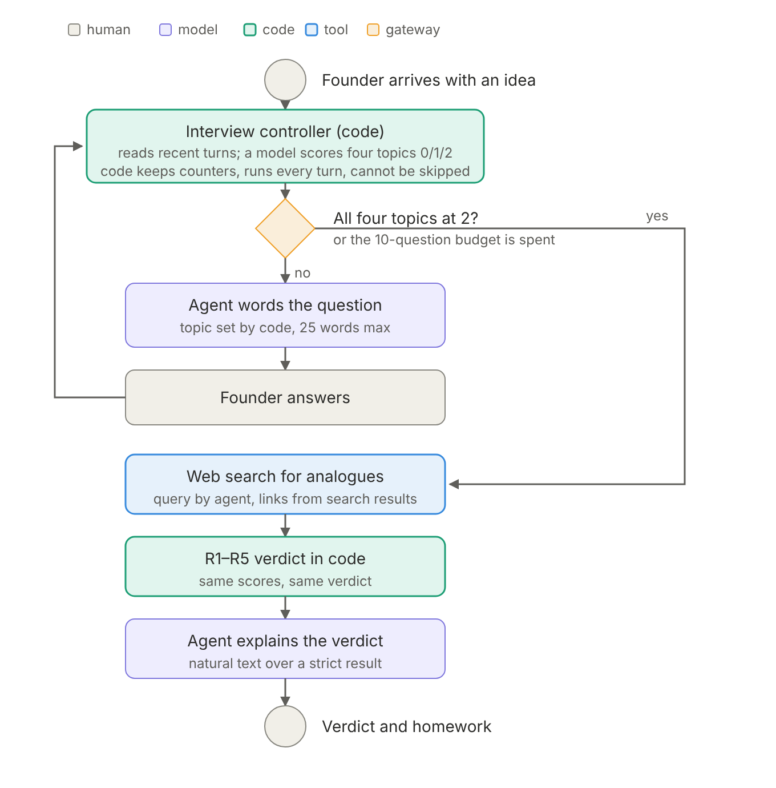

# AI Screener for Startup Accelerator Applications

An AI interviewer that does the first-pass screening of startup applications. In 4–10 questions it checks whether there are facts behind the idea, looks up similar products on the web, and gives a pass or fail verdict computed by deterministic code, with targeted homework for the founder.

An independent prototype, built in [Langflow](https://langflow.org) around the screening needs of a major bank's accelerator programme. It contains no client code, data or prompts.

<p align="center">
  
</p>

## The product case

**Problem.** Accelerator experts spend their first call with every applicant on the same basic questions, and most ideas fail them. Experts' time goes to screening instead of to the strongest teams.

**User.** The founder gets a short interview and clear homework. The programme team gets a consistent verdict before any expert time is spent.

**Key decision: the model speaks, the code decides.** The interview logic was first a tool the agent was told to call after every answer. In a test interview it called the tool on 1 turn out of 5. I moved the logic into a controller node that Langflow runs on every turn, and left the model the wording. In the same test the controller ran on 5 turns out of 5. A model still scores the answers; code owns everything around that score: attempt counters, the question budget, the next topic and the verdict.

**Quality bar.** Four topics, each scored 0, 1 or 2, based on Customer Development, The Mom Test, Jobs to Be Done and Lean Startup. An application passes only with 2 on all four. The verdict rules (R1–R5) are plain code, so the same scores always give the same verdict.

**Model choice.** Each role is a separate setting, so models can be swapped. I compared seven models for the interviewer role on the turn where the two-attempt rule kept failing. Two held the rule without hinting at the answer; I chose DeepSeek V4 Flash and kept Qwen 3.6 as the fallback.

| Role | Model | Why |
|---|---|---|
| Interviewer | `deepseek-v4-flash` | Kept the two-attempt rule and did not hint at answers |
| Scoring | `gpt-oss-120b` | Strict JSON at temperature 0, about three times faster than DeepSeek (6.9 s vs 19.6 s) |
| Web search | `yandexgpt/latest` with Yandex's search tool | Returns the URLs the search actually cited |

**Results (synthetic interviews).** On Yandex AI Studio: 6–20 s per question turn, 4–5 questions against a budget of 10, about ₽12 (≈ $0.15) per application. The current version also ran end to end on NeuralDeep's free tier: a strong founder passed after 3 questions, a weak one got "improve" with targeted homework after 7. Method, transcripts and caveats: [docs/model-evaluation.md](docs/model-evaluation.md).

**What it would take to go live.** A labelled set of real applications scored by experts, to measure how often the AI agrees with them. Scores still come from a model, so this is the precondition for production use.

## Architecture

```
Chat Input ─┬──────────────────────────────► Agent (input)
            └──► Interview Controller ──────► Agent (system prompt)

Chat Model ─────────────────────────────────► Agent (model)
Verdict R1-R5 (tool) ───────────────────────► Agent (tools)
Web Search (tool) ──────────────────────────► Agent (tools)
Agent ──────────────────────────────────────► Chat Output
```

| Component | Role | Who decides |
|---|---|---|
| Interview Controller | Has a model score the open topics, keeps attempt counters and the question budget, picks the next topic, builds the agent's instructions | Code (scores: model) |
| Agent | Phrases the question (its instructions set a 25-word limit), explains the verdict | Model |
| Verdict R1-R5 | Applies the pass rules to the saved scores and writes the founder-facing text; takes no arguments | Code |
| Web Search | Finds similar products, counts the distinct sites cited | Tool |

The controller, the verdict and the search share state through a companion session (`<session id>::interview-state`) that the agent's chat memory never loads, so the interviewer model does not see the scores. Why each piece is built this way: [docs/DECISIONS.md](docs/DECISIONS.md).

## How to run

1. Run Langflow 1.11.1, the version the flow was built on.
2. Create a custom component for each file in `components/` and paste in its code.
3. Wire the flow:

   | From | To |
   |---|---|
   | Chat Input → Chat Message | Agent → Input, and Interview Controller → User Message |
   | Interview Controller → System Prompt | Agent → Agent Instructions |
   | Yandex Chat Model → Language Model | Agent → Language Model |
   | Verdict R1-R5, in Tool Mode | Agent → Tools |
   | Yandex Web Search, in Tool Mode | Agent → Tools |
   | Agent → Response | Chat Output → Inputs |

4. Put your Yandex AI Studio API key and folder ID into Yandex Chat Model, Interview Controller and Yandex Web Search. To run on another provider instead, see below.
5. Optional: paste `components/agent_fallback_prompt.txt` into the Agent's instructions field. The controller's connection overrides it; if that connection is ever lost, the agent still interviews topic by topic, without scores or a verdict, instead of running with an empty prompt.

There is no ready-to-import flow file yet; `components/` and the wiring table above describe the whole flow.

### Free testing on NeuralDeep

The flow also runs on [NeuralDeep](https://neuraldeep.tech)'s free tier, which needs no Yandex account. In all three model components:

| Setting | Value |
|---|---|
| API Key | your NeuralDeep key |
| API Base URL (advanced) | `https://api.neuraldeep.ru/v1` |
| Model | `qwen3.6-35b-a3b-noreason` |
| Yandex Folder ID | leave empty |

Free-tier limits, as the API reported them for a free key in November 2026:

| Limit | Free tier |
|---|---|
| Chat requests | 400 per 3-hour window (fixed UTC windows), 2,000 per week |
| Rate | 20 requests per minute, 3 at the same time |
| Request size | 46,112 input tokens per request |
| Web search | 30 searches per day, 300 per month |
| Gateway timeout | 900 s (the components give up after 90 s) |

An interview uses about 2 chat requests per question and 4–5 for the final turn; the two test interviews (3 and 7 questions) used 27 requests together. Retrying many times after a limit error triggers a 60-minute pause, so wait as long as the error's `Retry-After` header says. The free tier does not include `gpt-oss-120b` or DeepSeek, so all three roles run on Qwen 3.6. That is enough to test the flow, but not to judge scoring quality (see [model-evaluation.md](docs/model-evaluation.md)).

## Known limitations

- **Scores come from a model**, so the same transcript can be graded slightly differently. The verdict rules are deterministic; their inputs are not.
- **No labelled dataset yet**, so scoring consistency has not been measured.
- **Two tested providers.** Yandex AI Studio (default) and NeuralDeep. Any other OpenAI-compatible endpoint with the Responses API should work for the interview and the scoring, but the web search only knows those two.
- **Last write wins.** State is saved once per turn; two turns sent to the same session at the same moment would overwrite each other. That is fine for one person chatting; under load it needs a lock.
- **The market count is a proxy**: the number of distinct websites the search cited, not a verified list of competitors.
- **Scoring call timeout is 90 s.** One hung request made a turn take about 96 s.

## Repository

| Path | Contents |
|---|---|
| `components/` | The Langflow custom components, one file each, plus the agent's fallback prompt |
| `docs/DECISIONS.md` | Design decisions and the evidence for each |
| `docs/model-evaluation.md` | Model comparison, latency and cost measurements |
| `docs/images/` | Flow diagram (SVG source and PNG) |

The prompts and the bot's replies are in Russian by design: the programme's applicants are Russian-speaking.

No API keys are stored in the repository. MIT license.
